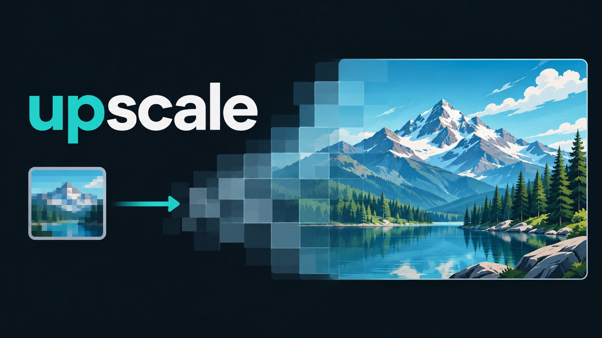
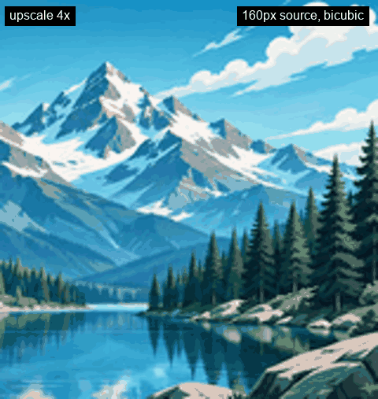

# upscale

[](https://github.com/wwylon/upscale/actions/workflows/ci.yml)
[](LICENSE)

Local AI image upscale. Chains Real-ESRGAN passes (via [spandrel](https://github.com/chaiNNer-org/spandrel)) to reach any target scale, with feather-blended overlapping tiles so large outputs have no seams. Runs on CPU or an NVIDIA GPU; nothing leaves your machine except the one-time model download.





> Not related to other projects named "upscaler" on GitHub or PyPI. The package, the import name and the command are all `upscale`.

## Install

```bash
pip install "git+https://github.com/wwylon/upscale.git"   # or: pipx install git+https://github.com/wwylon/upscale.git
```

The pip install pulls PyTorch (large, slow first install). A PyTorch-free build exists only as the Windows desktop app (ONNX Runtime); see [docs/develop.md](docs/develop.md).

From a clone:

```bash
pip install -e .
pip install -e ".[server]"    # web UI + job API
pip install -e ".[mcp]"       # MCP tools for agents
```

## First win

```bash
upscale upscale input.png output.png --scale 4 --cpu
```

Use `--target-size 8000` for a target long edge instead of a factor, drop `--cpu` to use the GPU, and `--fast` for the quick SPAN model. Models download on first use and are hash-verified.

```bash
upscale models list              # built-in models
upscale suggest input.png        # heuristic model pick
upscale serve                    # local web UI at http://127.0.0.1:8787/en/
upscale mcp                      # MCP tools over stdio
```

Equivalent module form: `python -m upscale upscale ...`

## Highlights

- Exact scale (`--scale`) or target long edge (`--target-size`); extra passes only when needed
- Tile size chosen from free VRAM; very large frames spill to disk between passes
- Swappable models: Real-ESRGAN family, HAT, SPAN, community weights, or your own `.pth`
- Large outputs saved as BigTIFF; alpha preserved
- Web UI in several languages; Windows desktop build uses ONNX Runtime (no PyTorch)
- No telemetry

## Library

```python
from upscale import UpscaleConfig, execute

execute(UpscaleConfig(input="in.png", output="out.png", scale=4, cpu=True))
```

## Documentation

- [CLI reference](docs/cli.md)
- [HTTP and MCP API](docs/api.md)
- [Development, desktop build, layout](docs/develop.md)
- [Android skeleton](docs/android.md)

## Tests

```bash
pip install -e ".[dev,server,mcp]"
pytest
```

MIT licensed. See [CONTRIBUTING.md](CONTRIBUTING.md) and [SECURITY.md](SECURITY.md).
